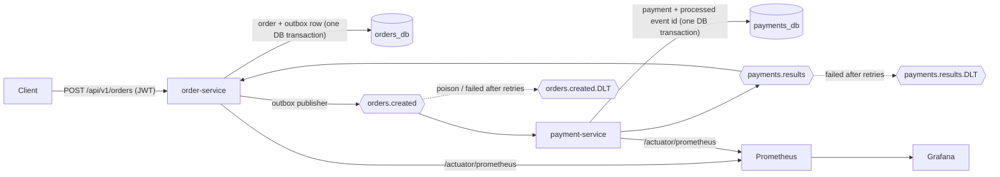
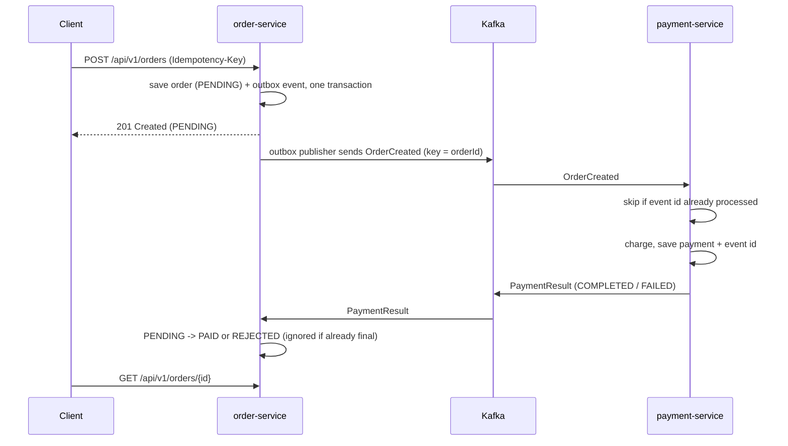

# Event-Driven Order Processing Platform


Two Spring Boot microservices that handle an order and its payment through **Apache Kafka**. The design follows the patterns production payment and order systems rely on: a **transactional outbox**, **idempotent consumers**, **retries with dead-letter topics** and a **choreographed saga**. The project also shows a **JWT-secured REST API**, **Testcontainers** integration tests, **Prometheus/Grafana** metrics, and deployment to **Kubernetes** or **AWS ECS (Terraform)**.

**Stack:** Java 21 · Spring Boot 3.4 · Spring Kafka · Spring Data JPA · Spring Security (OAuth2 resource server, JWT) · PostgreSQL 16 · Flyway · Apache Kafka 3.8 (KRaft) · JUnit 5 · Mockito · Testcontainers · Micrometer · Prometheus · Grafana · Docker · Kubernetes · Terraform (AWS ECS Fargate) · GitHub Actions

---

## Architecture





## Design decisions

| Problem | Solution in this project |
|---|---|
| **Dual write**: saving to the DB and publishing to Kafka can't share one transaction | **Transactional outbox**. The order and its event are written in the same DB transaction; `OutboxPublisher` relays pending rows to Kafka in order. |
| Kafka delivers **at least once**, so duplicates happen | **Idempotent consumer**. payment-service stores each `eventId` in `processed_events` together with the payment. One payment per order is enforced by a unique key. order-service ignores results for orders that are no longer `PENDING`. |
| Client retries a POST after a timeout | **`Idempotency-Key` header**. The same key returns the original order (200) instead of creating a second one. |
| One bad message blocking a partition | **`DefaultErrorHandler`**: 3 retries with back-off, then **`DeadLetterPublishingRecoverer`** to `<topic>.DLT`. Invalid data (bad JSON, missing fields) skips the retries. |
| Ordering | Records are keyed by `orderId`, so every event for one order goes to the same partition. |
| Concurrent updates to one order | JPA `@Version` **optimistic locking**. |
| Distributed transaction across services | A **choreographed saga**: each service reacts to events, with no central coordinator and no 2PC. |
| Security | **Stateless OAuth2 resource server**. Scope-based authorisation (`orders:read`, `orders:write`); customers only see their own orders. Unknown and foreign orders both return 404, so ids can't be probed. |
| Schema changes | **Flyway** migrations; Hibernate never alters the schema (`ddl-auto: none`). |
| Observability | Micrometer business metrics (`orders_created_total`, `payments_processed_total{status}`, `payments_duplicates_total`, `outbox_pending`), HTTP latency histograms, and Kubernetes liveness/readiness probes. |

## Run it locally

Requirements: Docker Desktop (Compose v2). Java 21 and Maven are only needed to run the tests outside Docker.

```bash
docker compose up --build
```

| URL | What |
|---|---|
| http://localhost:8081/swagger-ui.html | Order API (Swagger UI) |
| http://localhost:9090 | Prometheus |
| http://localhost:3000 | Grafana, admin/admin, dashboard "Order Platform" |

### Try the flow

```bash
# 1. Get a demo token (the "demo" profile only, which docker-compose enables)
TOKEN=$(curl -s -X POST "http://localhost:8081/dev/token?customerId=customer-1" | jq -r .access_token)

# 2. Place an order (re-send with the same Idempotency-Key and you get the same order back)
curl -s -X POST http://localhost:8081/api/v1/orders \
  -H "Authorization: Bearer $TOKEN" -H "Content-Type: application/json" \
  -H "Idempotency-Key: demo-001" \
  -d '{"amount": 49.99, "currency": "GBP"}'

# 3. A moment later the payment result has arrived
curl -s http://localhost:8081/api/v1/orders/<order-id> -H "Authorization: Bearer $TOKEN"   # status: PAID

# Amounts over 5000.00 or unsupported currencies end up REJECTED with a reason
```

On Windows PowerShell:

```powershell
$TOKEN = (Invoke-RestMethod -Method Post "http://localhost:8081/dev/token?customerId=customer-1").access_token
Invoke-RestMethod -Method Post http://localhost:8081/api/v1/orders -Headers @{Authorization="Bearer $TOKEN"; "Idempotency-Key"="demo-001"} -ContentType "application/json" -Body '{"amount": 49.99, "currency": "GBP"}'
```

## Tests

```bash
mvn verify
```

| Level | What | Tools |
|---|---|---|
| Unit | Domain rules, service logic, payment rules | JUnit 5, Mockito, AssertJ |
| Web slice | Security (401/403), validation (400), problem-details (404), idempotent replay | `@WebMvcTest`, spring-security-test |
| Integration | Full flow per service: outbox → Kafka → consumer, duplicates, poison message → DLT | `@SpringBootTest`, `@EmbeddedKafka`, H2 |
| Containers (`*IT`) | Same flows against real PostgreSQL 16 and Kafka 3.8 | Testcontainers (needs Docker) |

Coverage reports: `*/target/site/jacoco/index.html`. GitHub Actions runs all of the above on every push and builds the Docker images.

### Load test

```bash
k6 run loadtest/create-orders.js     # 100 orders/s for 1 minute, fails if p95 > 300 ms or errors > 1%
```

## Deploy

- **Kubernetes**: `kubectl apply -f k8s/` (Deployments with probes and resource limits, Services, an HPA for order-service). Point the ConfigMap at your Kafka and PostgreSQL.
- **AWS**: `terraform/` creates ECR repositories, an ECS Fargate cluster and services, CloudWatch logs, and IAM roles. Secrets live in SSM Parameter Store. Copy `terraform.tfvars.example` to `terraform.tfvars`, then run `terraform init && terraform apply`. Kafka (Amazon MSK) and PostgreSQL (Amazon RDS) are passed in as variables. AWS charges apply.

## Project layout

```
common-events/      Event contracts shared by both services (Java records)
order-service/      REST API, JWT security, outbox, payment-result consumer
payment-service/    OrderCreated consumer, idempotency, simulated payment gateway
infra/              Postgres init, Prometheus and Grafana provisioning
k8s/                Kubernetes manifests
terraform/          AWS ECS Fargate infrastructure
loadtest/           k6 script
docs/               Interview guide
```

## What I would add next

- Debezium CDC instead of polling the outbox table
- Schema Registry with Avro or Protobuf contracts
- Distributed tracing with OpenTelemetry (trace id carried through Kafka headers)
- A real identity provider (Keycloak / Cognito) instead of the demo token endpoint
- Payment gateway calls through Resilience4j (timeouts, circuit breaker)

## Licence

MIT
